# Credit Card Insurance RAG — Bank-Agnostic Parent-Document Architecture

[](#6-testing--verification)
[](https://www.python.org/)
[](https://qdrant.tech/)
[-purple.svg)](https://huggingface.co/BAAI/bge-base-en-v1.5)
[-orange.svg)](https://ollama.com/)

A production-grade, bank-agnostic **Retrieval-Augmented Generation (RAG)** system engineered specifically for complex, high-liability **Credit Card Insurance Booklets & Certificates of Insurance** (20–60 page PDFs from TD, CIBC, Scotiabank, etc.).

---

## 1. Architectural Highlights

Traditional dense-only RAG pipelines fail catastrophically on legal insurance contracts because semantic embeddings obscure exact numerical limits (e.g. `$100,000` vs `$85,000` MSRP), flat chunking severs exclusion clauses from benefit schedules, and standard LLM prompts hallucinate coverage.

This system solves these domain challenges with a **6-Pillar Architecture**:

1. **Two-Tier Parent-Document Architecture (Small-to-Big)**:
   * **Child Chunks** (~80–150 words): Act as high-precision semantic & lexical "search beacons" tagged with exact page numbers.
   * **Parent Sections** (~600–1,500 words): Sourced from Markdown `#`, `##`, and `###` document headers to deliver complete, unsevered legal context (benefit schedule + exclusions + deductibles) to the LLM.
2. **Qdrant Cloud Native Hybrid (Dense + Sparse BM25)**:
   * Unified cloud vector collection (`insurance_chunks`) storing named **Dense** (`BAAI/bge-base-en-v1.5`, 768-d) and **Sparse BM25** vectors.
   * Server-side **Reciprocal Rank Fusion (RRF)** ($k=60$) executed in a single network round-trip.
   * Pre-filtered search by `card_id` index scales seamlessly to 30+ card portfolios.
3. **Universal Bank-Agnostic Markdown Parser**:
   * Uses `pymupdf4llm` to extract structured Markdown with tables and layout intact.
   * Tracks line-by-line physical page numbers (`<!-- Page X -->`) across continuous documents.
   * Universal heading hierarchy with zero bank-specific branching logic or regex.
4. **Grounded, 4-Part Enforced LLM Synthesis**:
   * Local open-weights model (`qwen2.5:7b` via Ollama) running locally on private hardware.
   * Zero-hallucination prompt enforcing strict negative rejection (e.g. explicitly rejecting pet medical coverage).
   * Generates a structured 4-part schema: *1. Direct Answer*, *2. Coverage Limits & Key Details*, *3. Conditions & Exclusions*, *4. Certificate Citations*.
5. **Full-Stack Dark Fintech Web Application**:
   * FastAPI backend serving Server-Sent Events (SSE) token streaming.
   * Pure Vanilla HTML5/CSS3/ES6 JavaScript frontend with zero framework dependencies.
   * Collapsible source citation drawer featuring exact page badges and expandable full-section views.
6. **Multi-Card Policy Comparison Engine**:
   * Select 2–3 cards simultaneously (TD vs CIBC vs Scotia) with parallel fan-out hybrid retrieval.
   * Cross-bank alias resolution normalizing short identifiers to cloud points.
   * Comparative synthesis outputting side-by-side comparison matrix tables, key winner badges, and segmented citations.

---

## 2. End-to-End System Pipeline

```mermaid
flowchart TD
    subgraph Ingestion ["1. Document Ingestion & Universal Layout Parsing"]
        PDF["Raw Digital PDF (data/{bank}/*.pdf)"] --> PyMuPDF4LLM["pymupdf4llm Markdown & Table Extraction"]
        PyMuPDF4LLM --> UniversalParser["Universal Heading-Stack Parser (#, ##, ###)"]
        UniversalParser --> ParentSections["ParentSection Objects (~600-1500 words)"]
        ParentSections --> ChildChunker["Semantic Block Chunker (Tables, Paragraphs, Sentences)"]
        ChildChunker --> ChildChunks["ChildChunk Objects (~80-150 words with page_number)"]
    end

    subgraph Storage ["2. Cloud-Native Qdrant Storage Layer"]
        ChildChunks --> DenseEmbedder["Dense Embedder (bge-base-en-v1.5, 768-d)"]
        ChildChunks --> BM25Vectorizer["Cloud BM25 Sparse Vectorizer"]
        DenseEmbedder & BM25Vectorizer --> QdrantCloud["Qdrant Cloud Cluster (insurance_chunks collection)"]
        ParentSections -.->|Denormalized in Payload| QdrantCloud
    end

    subgraph Retrieval ["3. Cloud Hybrid RRF & Parent Expansion Engine"]
        UserQuery["User Natural Language Question"] --> DualEncode["Encode Dense Vector + BM25 Sparse Query"]
        DualEncode --> CloudRRF["Qdrant Cloud Single query_points() with card_id Filter & Server-Side RRF"]
        CloudRRF --> TopChildren["Top-8 Child Chunks (Search Hits)"]
        TopChildren --> Deduplicator["Parent Deduplication by parent_id"]
        Deduplicator --> TopParents["Top 2-3 Unique Parent Sections (~1,500-2,500 words)"]
    end

    subgraph Synthesis ["4. Grounded Synthesis & Citations"]
        TopParents --> PromptBuilder["Full Parent Context Prompt"]
        PromptBuilder --> Ollama["Local LLM (qwen2.5:7b via Ollama /api/chat)"]
        Ollama --> FourPartSchema["4-Part Schema: Direct Answer, Limits, Exclusions, Citations"]
    end

    subgraph Delivery ["5. Full-Stack Web App"]
        FourPartSchema --> FastAPISSE["FastAPI Server-Sent Events (SSE /api/query)"]
        FastAPISSE --> WebUI["Dark Fintech Web UI (HTML5 / Vanilla CSS / ES6 JS)"]
        TopChildren --> CitationsDrawer["Real-Time Child-Highlighted Citation Drawer (Exact Pages)"]
    end
```



---

## 3. Phase Status Overview

| Phase | Title & Focus Area | Deliverables & Core Technologies | Status | Verification & Benchmarks | Detailed Guide |
| :--- | :--- | :--- | :--- | :--- | :--- |
| **Phase 1** | **Ingestion & Universal Layout Parsing** | `src/registry.py`, `src/parser.py`, `data/extracted/*.md`<br>*(PyMuPDF, pymupdf4llm, Unicode normalizer)* | **COMPLETE (100%)** ✅ | 6/6 tests passing. All 10 TD baseline policies verified without bank regex. | [Phase 1 Guide](docs/phases/PHASE_1_INGESTION.md) |
| **Phase 2** | **Hybrid Retrieval & Benchmark Baseline** | `src/storage.py` (Local fallback), `src/retriever.py`, local RRF fusion ($k=60$)<br>*(BM25Plus, sentence-transformers/all-MiniLM-L6-v2)* | **COMPLETE (100%)** ✅ | 10/10 TD benchmark tests passing (`tests/test_benchmark_td.py`). Stopword pruning and exact number matching. | [Phase 2 Guide](docs/phases/PHASE_2_RETRIEVAL.md) |
| **Phase 3** | **Grounded Synthesis & Citation Guardrails** | `src/generator.py`, `scripts/query.py`, `scripts/eval_synthesis.py`<br>*(qwen2.5:7b via local Ollama, 4-part response schema)* | **COMPLETE (100%)** ✅ | 4/4 generator tests passing. 5/5 synthesis evaluation cases pass with 100% negative rejection. | [Phase 3 Guide](docs/phases/PHASE_3_SYNTHESIS.md) |
| **Phase 4** | **Full-Stack Web App & Multi-Bank Verification** | `api/main.py`, `frontend/` (Dark Fintech UI), `tests/test_multibank.py`<br>*(FastAPI, Uvicorn, SSE streaming, Vanilla HTML5/CSS3/ES6)* | **COMPLETE (100%)** ✅ | 4/4 API tests + 3/3 multi-bank tests passing (`tests/test_api.py`, `tests/test_multibank.py`). Zero build step. | [Phase 4 Guide](docs/phases/PHASE_4_FULLSTACK_UI.md) |
| **Phase 5** | **Parent-Document Retrieval & Qdrant Cloud Hybrid** | `src/bm25_vectorizer.py`, `src/storage.py` (`QdrantStorageManager`), `src/retriever.py` (`HybridParentRetriever`), `scripts/index_all_cards.py`<br>*(Qdrant Cloud, BAAI/bge-base-en-v1.5 768-d on GPU, server-side RRF)* | **COMPLETE (100%)** ✅ | 37/37 tests passing in suite. CIBC (`$100,000` MSRP, medical duration) & TD benchmarks verified. | [Phase 5 Guide](docs/phases/PHASE_5_PARENT_DOCUMENT_QDRANT.md) |
| **Phase 6** | **Multi-Card Policy Comparison Engine** | `src/retriever.py` (`retrieve_multicard`), `src/generator.py` (`COMPARISON_SYSTEM_PROMPT`), `api/main.py` (`/api/compare` SSE), `frontend/` (Matrix UI, mode switcher), `scripts/compare_cards.py`<br>*(Parallel hybrid fan-out, cross-bank alias resolution, side-by-side matrix)* | **COMPLETE (100%)** ✅ | **48/48 tests passing** in full test suite (11/11 comparison tests in `tests/test_comparison.py`). Comprehensive 5-rider cross-bank benchmark across TD, CIBC, and Scotia verified. | [Phase 6 Guide](docs/phases/PHASE_6_COMPARISON.md) |

---

## 4. Quick Start & Execution Guide

### 4.1 Prerequisites
- Python 3.12+ (tested on Python 3.13)
- [Ollama](https://ollama.com/) running locally with model: `ollama pull qwen2.5:7b`
- Qdrant Cloud account & API Key (or local in-memory fallback)

### 4.2 Environment Configuration
Copy `.env.example` to `.env` and fill in your Qdrant Cloud credentials:
```powershell
cp .env.example .env
```
Ensure your `.env` contains:
```env
QDRANT_URL=https://<your-cluster-id>.ca-central-1-0.aws.cloud.qdrant.io
QDRANT_API_KEY=<your-secret-api-key>
EMBEDDING_MODEL=BAAI/bge-base-en-v1.5
EMBEDDING_DIM=768
EMBEDDING_DEVICE=cuda
LLM_MODEL=qwen2.5:7b
OLLAMA_BASE_URL=http://localhost:11434
```

### 4.3 Index All Insurance Booklets
Run the automated cloud ingestion script:
```powershell
# Index all cards in data/ to Qdrant Cloud
python scripts/index_all_cards.py

# Or index a specific card by ID or name
python scripts/index_all_cards.py --card td_aeroplan_vip
python scripts/index_all_cards.py --card cibc_aeroplan_vip
```

### 4.4 Launch the Web Application
Start the FastAPI server:
```powershell
python -m uvicorn api.main:app --reload --port 8001
```
Open your browser at: **`http://localhost:8001/`**

### 4.5 Run the Interactive CLI Query Tool
Test questions directly in the terminal with live streaming:
```powershell
python scripts/query.py --card td_aeroplan_vip "What is the maximum MSRP for rental car collision coverage?"
```

### 4.6 Compare Cards Side-by-Side via CLI
Compare 2–3 cards side by side in the terminal with live streaming:
```powershell
python scripts/compare_cards.py --cards td_aeroplan_vip cibc_aeroplan_vip scotia_passport_vip --query "Compare rental car collision limits and duration"
```

### 4.7 Run the Automated Test Suite
Run all 48 unit, integration, and cross-bank benchmark tests:
```powershell
pytest tests/ -v
```

---

## 5. Repository Structure

```text
rag-practice/
├── api/
│   └── main.py                     # FastAPI backend (SSE streaming /api/query & /api/compare, REST, static mounting)
├── data/                           # Raw digital PDF insurance certificates (strictly input documents)
│   ├── cibc/                       # CIBC insurance booklets
│   ├── scotia/                     # Scotiabank insurance certificates
│   └── td/                         # TD Aeroplan insurance certificates
├── data/extracted/                 # Universal converted continuous Markdown documents (.md)
├── docs/                           # Comprehensive technical documentation
│   ├── ARCHITECTURE_AND_TECHNICAL_REFERENCE.md  # Deep-dive engineering reference & beginner guide
│   ├── ROADMAP.md                  # Development phase roadmap and status
│   ├── design_changes/             # Formal Design Change Records (DCR-001, DCR-002, DCR-003)
│   └── phases/                     # Architectural guides for Phases 1 through 6
├── frontend/                       # Dark Fintech UI (Zero-build HTML5/CSS3/ES6 JS)
│   ├── app.js                      # Dual-mode switcher, SSE consumer, matrix renderer, citation drawer
│   ├── index.html                  # Semantic application markup
│   └── style.css                   # Custom fintech design tokens, matrix tables, and responsive styles
├── scripts/                        # Operational CLI tools & benchmarks
│   ├── compare_cards.py            # Standalone terminal multi-card comparison client
│   ├── eval_synthesis.py           # Automated evaluation of LLM grounding and negative controls
│   ├── index_all_cards.py          # Master CLI ingestion tool for Qdrant Cloud
│   ├── inspect_policies.py         # Diagnostic outline and policy transition inspector
│   └── query.py                    # Terminal streaming single-card Q&A client
├── src/                            # Core pipeline implementation
│   ├── bm25_vectorizer.py          # Cloud-native BM25 sparse vectorizer & tokenizer
│   ├── generator.py                # Grounded LLM generator (qwen2.5:7b) with SSE streaming
│   ├── parser.py                   # Universal layout parser (ParentSection & ChildChunk)
│   ├── registry.py                 # Dynamic multi-bank card discovery & metadata
│   ├── retriever.py                # HybridParentRetriever (Qdrant RRF) + legacy retriever
│   └── storage.py                  # QdrantStorageManager (cloud dual-vector) + local fallback
└── tests/                          # 37 automated tests across 9 test suites
    ├── test_api.py                 # REST & SSE endpoint tests
    ├── test_benchmark_cibc.py      # CIBC parent-document precision benchmark
    ├── test_benchmark_td.py        # TD 10-question ground-truth precision benchmark
    ├── test_bm25_vectorizer.py     # BM25 sparse vectorizer unit tests
    ├── test_generator.py           # LLM synthesis and prompt formatting tests
    ├── test_multibank.py           # Multi-bank discovery & ingestion tests
    ├── test_parser.py              # Universal layout & parent-child parsing tests
    ├── test_registry.py            # Dynamic card discovery tests
    ├── test_retriever.py           # RRF ranking and parent deduplication tests
    ├── test_storage.py             # Local storage fallback tests
    └── test_storage_qdrant.py      # Qdrant Cloud storage manager tests
```

---

## 6. Architectural Comparison: Legacy vs Current

| Capability | Legacy Approach (Phase 1–4) | Current Parent-Document Architecture (Phase 5) |
| :--- | :--- | :--- |
| **Chunking Resolution** | Flat fixed-size chunks (~400 characters) | Two-tier: Child (~80–150 words) + Parent (~600–1,500 words) |
| **Synthesis Context** | Disjointed chunks (often missing exclusions) | Full legal sections (denormalized parent content in payload) |
| **Table Integrity** | Tables severed across chunks | Tables preserved intact or grouped in 3-row cluster blocks |
| **Lexical Engine** | Local `rank_bm25.pkl` file on disk | Cloud-native sparse vector BM25 in Qdrant Cloud |
| **Dense Embeddings** | `all-MiniLM-L6-v2` (384-d) | `BAAI/bge-base-en-v1.5` (768-d on NVIDIA GPU) |
| **Vector Storage** | Local `.index/<card>/embeddings.npy` | Qdrant Cloud collection (`insurance_chunks`) with `card_id` filtering |
| **Rank Fusion** | Client-side Python reciprocal rank math | Qdrant Cloud server-side RRF fusion in 1 network request |
| **Bank Dependency** | Initial heuristic heading tags | 100% universal Markdown typography (`#`, `##`, `###`, `|`) |
| **Test Coverage** | 27 passing tests | 37 passing tests across 9 test files (100% pass rate) |

---

## 7. Testing & Verification

The repository enforces strict continuous verification:
```powershell
pytest tests/ -v
```

All 37 test cases validate:
* Dynamic discovery across CIBC, TD, and Scotiabank certificates.
* Universal parent-child layout parsing, table preservation, and breadcrumb generation.
* Cloud-native BM25 tokenization and sparse vector creation.
* Dual-vector upsert and payload indexing in Qdrant.
* Hybrid search with server-side RRF fusion and parent deduplication.
* Ground-truth precision on exact numerical benchmarks:
  - Flight delay coverage: `$1,000` cap after 4-hour delay (Page 33).
  - Rental car collision MSRP: `$85,000` (TD Page 38) and `$100,000` (CIBC).
  - Mobile device deductible: Tiered deductible schedule with `$1,500` limit (TD Page 46).
  - Pre-existing medical condition stability: 90-day stability requirement (TD Page 7).
  - Negative control guardrail: Explicit rejection of pet medical coverage (100% pass rate).

---

## 8. Documentation Index

* **[Architecture & Technical Deep-Dive](docs/ARCHITECTURE_AND_TECHNICAL_REFERENCE.md)**: Exhaustive manual covering algorithmic trade-offs, edge cases, file-by-file walkthrough, and a plain-English beginner's guide to RAG.
* **[Development Roadmap](docs/ROADMAP.md)**: Current status of all 5 project phases.
* **[Phase Guides](docs/phases/README.md)**:
  - [Phase 1: Ingestion & Breadcrumb Parsing](docs/phases/PHASE_1_INGESTION.md)
  - [Phase 2: Hybrid Retrieval & Local RRF](docs/phases/PHASE_2_RETRIEVAL.md)
  - [Phase 3: Grounded Synthesis & Guardrails](docs/phases/PHASE_3_SYNTHESIS.md)
  - [Phase 4: Full-Stack Web App & Multi-Bank](docs/phases/PHASE_4_FULLSTACK_UI.md)
  - [Phase 5: Parent-Document Retrieval & Qdrant Cloud](docs/phases/PHASE_5_PARENT_DOCUMENT_QDRANT.md)
* **[Design Change Records](docs/design_changes/README.md)**:
  - [DCR-001: Phase 1 Parser Dual-Source Tracking](docs/design_changes/001_phase1_parser_hierarchical_tracking.md)
  - [DCR-002: Continuous Markdown Export on Ingestion](docs/design_changes/002_markdown_export_on_ingestion.md)
  - [DCR-003: Parent-Document Retrieval & Qdrant Cloud Migration](docs/design_changes/003_parent_document_qdrant_cloud.md)
