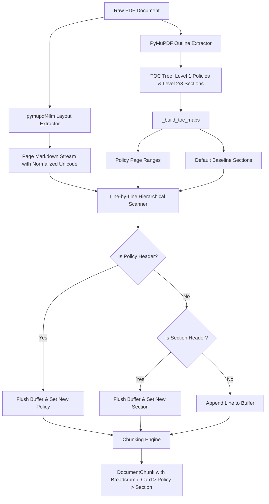

# Design Change Record: Phase 1 Parser & Hierarchical Breadcrumb Tracking

**ID:** DCR-001  
**Date:** 2026-10-23  
**Status:** Implemented & Verified ✅  
**Component:** `src/parser.py`, `tests/test_parser.py`, `scripts/inspect_policies.py`  
**Author:** AI Agent & Engineering Partner  

---

## 1. Context & Motivation

In the initial design of the credit card insurance RAG ingestion pipeline, `InsuranceDocParser` attempted to parse digital insurance PDFs into hierarchical Markdown chunks using `pymupdf4llm` and basic Markdown heading regex (`#` for Policy, `##` and `###` for Sections).

When tested against the baseline benchmark card (**TD Aeroplan Visa Infinite Privilege Card**, 52 pages, 10 distinct insurance policies), several critical architectural limitations surfaced:

1. **Heading Tag Inconsistency**: `pymupdf4llm` does not always tag top-level policy titles with `#`. In some pages, top-level policies are extracted as table cells (e.g., `|TRIP CANCELLATION / TRIP INTERRUPTION INSURANCE|`), bold text, or `##`.
2. **False Policy Switching**: Intra-page section headers (such as `# Section 2 - Introduction` on page 2) were matched by `#\s+(.+)`, inadvertently overwriting the current policy name with the section title.
3. **Mid-Page Policy Transitions**: In dense insurance booklets, policies do not cleanly align with physical page boundaries. Many policies terminate mid-page (e.g., page 34 starts with the end of Flight Delay and transitions at line 30 to Auto Rental). Assigning a single policy per page caused the ending of the previous policy to be misattributed to the incoming policy.
4. **Suppression of Intra-Page Subsections**: An earlier workaround that locked `current_policy` and `current_section` to a page-level TOC map had the adverse effect of suppressing all intra-page section changes (e.g., `## A. ELIGIBILITY`, `## B. COVERAGE PERIOD`, `## C. BENEFITS` on page 46).
5. **Unicode Normalization Issues**: Digital PDFs frequently contain non-breaking hyphens (`\u2011`), curly quotes (`\u2018`, `\u2019`, `\u201c`, `\u201d`), non-breaking spaces (`\u00a0`), and replacement characters (`\ufffd`), breaking exact keyword search and regex parsing.

---

## 2. Architectural Design Change

To solve these issues in a **bank-agnostic** manner without deterministic bank regex or hardcoded rules, we refactored `src/parser.py` around a **Dual-Source Outline & Layout Engine**.

---

## 3. Detailed Changes Implemented

### 3.1 Outline-Guided Policy Mapping (`_build_toc_maps`)
- Extracted Level-1 outline bookmarks from `doc.get_toc()` as the ground-truth policy definitions.
- Computed dynamic start and end page spans for each policy:
  $$\text{Span}(P_i) = [\text{Start}(P_i), \text{Start}(P_{i+1}) - 1]$$
- Filtered Level-2 and Level-3 sections within each policy's page span to guarantee sections from Policy $A$ never leak into Policy $B$.

### 3.2 In-Page Line Cleaner & Universal Policy Header Detection
- Stripped Markdown markers (`#`, `*`, `_`, `|`, `` ` ``) and HTML tags (`<u>`, `</u>`, `<mark>`) during heading checks.
- Matched cleaned lines against the canonical policy outline names (`known_policies_map`).
- Allows policy transitions to trigger on **the exact line of occurrence**, regardless of whether the Markdown tag was `#`, `##`, or `|TABLE|`.

### 3.3 Mid-Page Boundary Isolation & Deferral
- Before switching `current_policy` at a physical page boundary, the scanner checks if the upcoming page text contains an explicit in-page policy header.
- If an in-page policy header is detected later on that page, the parser **defers** the switch, allowing preceding lines (e.g. General Conditions, False Claim) to be correctly filed under the active previous policy.

### 3.4 Intra-Page Subsection Buffer Flushing
- When in-page section markers (`Section \d+`, `clean_text in known_sections`, or `## [A-Z]\.\s+.*`) are encountered, the parser flushes the active buffer immediately.
- Result: Multi-section pages (such as page 46 with Eligibility, Coverage Period, and Benefits) produce discrete, specifically tagged chunks rather than being coalesced under one generic heading.

### 3.5 Robust Unicode Normalization
- Centralized `normalize_text()` to convert non-standard Unicode hyphens (`\u2010`–`\u2015`), typographic quotes, non-breaking whitespace (`\u00a0`, `\u200b`, `\u202f`), and `\ufffd` into standard ASCII.

---

## 4. Verification & Validation Evidence

### 4.1 Policy Tree Inspection (`scripts/inspect_policies.py`)
Run on `data/td/TD Aeroplan Visa Infinite Privilege Card COI.pdf` (52 pages):
- **Policies Identified**: Exactly 10/10 policies matched.
- **Total Chunks**: 213 chunks.
- **Chunk Sizing**: Min = 5 words, Avg = 122 words, Max = 400 words.
- **Card Prefix Validation**: 100% chunks tagged with `[Card: TD Aeroplan Visa Infinite Privilege Card]`.
- **Page Validity**: 100% of chunks have valid `page_number` in $[1, 52]$.

### 4.2 Automated Unit Tests (`tests/test_parser.py`)
All 3 unit tests passed:
- `test_parser_creates_breadcrumbed_chunks`: Basic Markdown and breadcrumb generation.
- `test_multi_section_same_page_and_subsections`: Validates that intra-page section changes flush into distinct chunks on page 2.
- `test_policy_boundary_does_not_inherit_previous_policy_section`: Validates that policy transitions do not inherit sections from preceding policies.

---

## 5. Downstream Impact
- **Phase 2 (Hybrid Retrieval)**: Lexical BM25 and dense MiniLM vectors now receive breadcrumb-enriched context (`[Card: ...] > [Policy: ...] > [Section: ...] (Page X)`), eliminating false-positive matches across different insurance riders.
- **Phase 3 (Grounded Synthesis)**: The generator receives precise section and page numbers for zero-hallucination citations.
