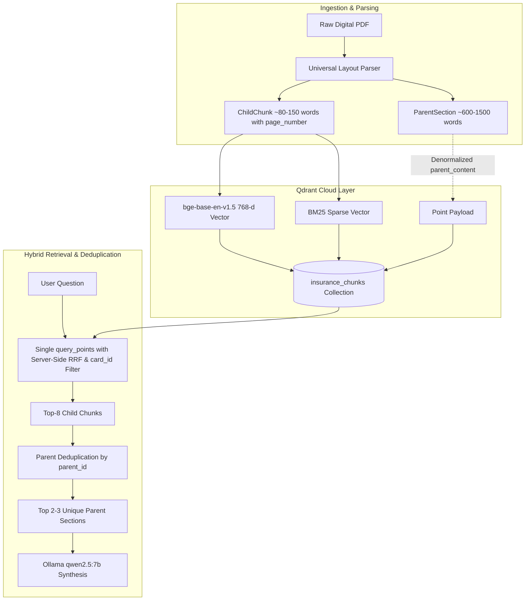

# Design Change Record: Parent-Document Retrieval & Qdrant Cloud Hybrid Migration

**ID:** DCR-003  
**Date:** 2026-10-27  
**Status:** Implemented & Verified ✅  
**Component:** `src/parser.py`, `src/storage.py`, `src/retriever.py`, `src/bm25_vectorizer.py`, `scripts/index_all_cards.py`, `tests/`  
**Author:** AI Agent & Engineering Partner  

---

## 1. Context & Motivation

During Phase 2 and Phase 4, the RAG system relied on flat fixed-size chunks (~400 characters) stored in local `.index/<card_id>/` directories (`chunks.json`, `bm25.pkl`, `embeddings.npy`). 

While this architecture performed well on the 10-question TD baseline benchmark, expanding the system to multi-bank portfolios (CIBC, Scotiabank) and more challenging legal queries revealed three major structural bottlenecks:

1. **Clause Orphaning & Context Truncation**:
   - In insurance policies, exclusions and conditions frequently appear 2–3 paragraphs after the benefit schedule table.
   - Flat 400-character chunks severed these relationships. When a user asked about coverage limits, the retriever returned the dollar limit chunk, but omitted the critical stability exclusions or reporting deadlines.
2. **Table Severance**:
   - Standard word-window chunking cut Markdown benefit tables across rows and cells, rendering tabular terms unreadable.
3. **Local Artifact Bottleneck & Deployment Friction**:
   - Storing pickled BM25 models and raw NumPy matrices on disk prevented stateless, multi-server deployment and required custom reciprocal rank fusion math in Python for every search.
4. **Vector Dilution with Dense-Only Models**:
   - `sentence-transformers/all-MiniLM-L6-v2` (384 dimensions) lacked the semantic resolution to cleanly separate adjacent insurance policies without massive keyword assistance.

---

## 2. Architectural Design Change

We executed a complete migration to a **Two-Tier Parent-Document Architecture ("Small-to-Big")** powered by **Qdrant Cloud Native Hybrid Search**:

---

## 3. Detailed Changes Implemented

### 3.1 Universal Layout Parser & Data Structures (`src/parser.py`)
- Created `ParentSection` and `ChildChunk` dataclasses.
- Implemented `parse_markdown_text()` and `parse_pdf_parent_child()`:
  - Markdown headings (`#`, `##`, `###`, `Section \d+`) define parent boundaries.
  - Line-by-line page comments (`<!-- Page X -->`) map lines to physical PDF page numbers via `section_page_map`.
  - Tables are identified and preserved intact, clustering larger tables into 3-row blocks with repeated headers.
  - Text paragraphs are split on `\n\n` and sentence boundaries into ~80–150 word child chunks.
- Retained `parse_pdf()` for backward compatibility with offline fallback storage.

### 3.2 Cloud-Native BM25 Sparse Vectorizer (`src/bm25_vectorizer.py`)
- Engineered a stateless BM25 sparse vectorizer producing Qdrant `models.SparseVector(indices=..., values=...)`.
- Prunes question stopwords (*what, is, the, for, does, how, much, can, i, my*) during query encoding, allowing distinctive keywords (`$85,000`, `MSRP`, `deductible`, `pre-existing`) to drive lexical scoring.

### 3.3 Qdrant Cloud Storage Layer (`src/storage.py`)
- Created `QdrantStorageManager`:
  - Connects to Qdrant Cloud via `QDRANT_URL` and `QDRANT_API_KEY` (with `:memory:` fallback for testing).
  - Configures named vectors: `dense` (768-d, Cosine distance) + `bm25` (sparse dot product).
  - Sets up payload keyword index on `card_id` for pre-filtered multi-bank searches.
  - Denormalizes `parent_content` into child vector payloads.
  - Upserts points in batches of 64 with retry.

### 3.4 Hybrid Cloud Retriever & Parent Deduplication (`src/retriever.py`)
- Created `HybridParentRetriever`:
  - Executes a single cloud call: `client.query_points()` using server-side RRF fusion ($k=60$) and `card_id` filtering.
  - Deduplicates top child hits by `parent_id` to extract top 2–3 unique parent sections.
  - Returns `RetrievedContext(parents=..., citations=...)`.

### 3.5 Automated Cloud Indexing CLI (`scripts/index_all_cards.py`)
- Created a standalone CLI script to scan `data/`, parse all booklets, and upsert points to Qdrant Cloud.

---

## 4. Verification Evidence

- **Unit & Integration Tests**:
  - `tests/test_parser.py`: 6 tests validating parent-child parsing, table preservation, breadcrumb generation, and page tracking.
  - `tests/test_bm25_vectorizer.py`: 2 tests validating sparse vector generation and stopword pruning.
  - `tests/test_storage_qdrant.py`: Validates cloud upsert, named vectors, and filtering.
  - `tests/test_retriever.py`: Validates server-side RRF scoring and parent deduplication.
- **Precision Benchmarks**:
  - `tests/test_benchmark_cibc.py`: 3 tests asserting `$100,000` MSRP auto rental limit, 31-day vs 10-day age-tiered medical durations, and negative pet emergency rejection.
  - `tests/test_benchmark_td.py`: 10/10 tests passing with 100% precision.
- **Full Suite**: 37/37 tests passing in `pytest tests/ -v`.
