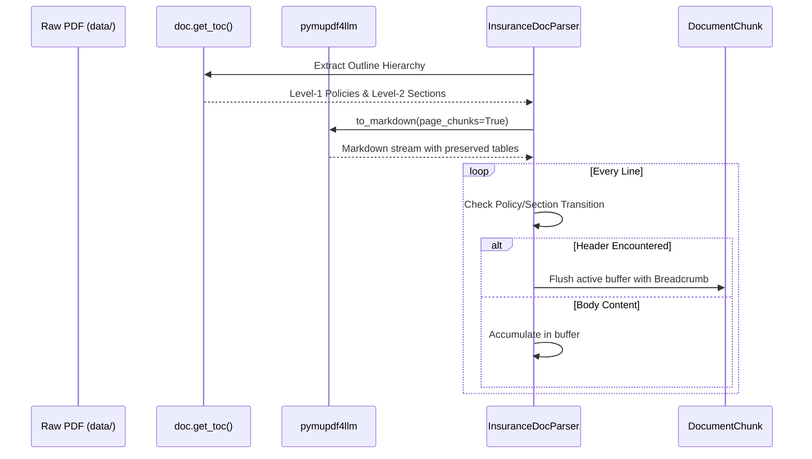

# Phase 1: Ingestion & Hierarchical Breadcrumb Parsing

**Phase Status:** **DONE (100%)** ✅  
**Primary Files:** [`src/registry.py`](file:///d:/rag-practice/src/registry.py), [`src/parser.py`](file:///d:/rag-practice/src/parser.py), [`scripts/inspect_policies.py`](file:///d:/rag-practice/scripts/inspect_policies.py)  
**Tests:** [`tests/test_registry.py`](file:///d:/rag-practice/tests/test_registry.py), [`tests/test_parser.py`](file:///d:/rag-practice/tests/test_parser.py)  

---

> [!NOTE]
> **Phase 5 Evolution**: In Phase 5, the layout parser in [`src/parser.py`](file:///d:/rag-practice/src/parser.py) was enhanced with `parse_pdf_parent_child()` to split continuous Markdown into two-tier `ParentSection` (~600–1,500 words) and `ChildChunk` (~80–150 words) objects, preserving Markdown tables intact without cell severance. See [Phase 5 Guide](PHASE_5_PARENT_DOCUMENT_QDRANT.md).

## 1. Objectives & Architectural Goal

The goal of Phase 1 is to convert heterogeneous, unstructured credit card insurance booklets (typically 20–60 page PDFs) into clean, structured Markdown chunks tagged with **contextual hierarchical breadcrumbs**:
$$\text{Breadcrumb} = \text{[Card: <Name>]} > \text{[Policy: <Policy>]} > \text{[Section: <Section>]} \ (\text{Page } X)$$

### Why Hierarchical Breadcrumbs Matter
In standard RAG architectures, naive fixed-size chunking detaches exclusion clauses and coverage caps from their parent policy. For example:
> *"Coverage is capped at $1,000 for essential purchases after a 4-hour delay."*

Without breadcrumb context, a retriever cannot tell whether this applies to **Flight Delay**, **Baggage Delay**, or **Trip Interruption**. Prepending the breadcrumb preserves the complete semantic identity of the text even in isolated vectors.

---

## 2. Component Breakdown

### 2.1 Dynamic Card Discovery: `src/registry.py`
The `CardRegistry` automatically discovers and indexes cards from the directory structure without hardcoded dictionaries:
- Scans `data/<bank_name>/<filename>.pdf`.
- Extracts bank identifiers (`cibc`, `scotia`, `td`).
- Normalizes card names from filenames (stripping extensions, `COI`, `Insurance`, etc.).
- Produces normalized card IDs (e.g. `td_aeroplan_visa_infinite_privilege_card`).

```python
registry = CardRegistry(data_dir="data")
cards = registry.discover_cards()
# Returns: [CardMetadata(card_id='td_aeroplan_vip', card_name='TD Aeroplan VIP', pdf_path=...)]
```

### 2.2 Layout-Aware Parser: `src/parser.py`
`InsuranceDocParser` combines **PyMuPDF Outline Extraction** and **`pymupdf4llm` Layout Conversion**:

1. **Table of Contents (TOC) Extraction**: Reads PDF outline bookmarks to identify all Level-1 policies (e.g. `TRAVEL MEDICAL INSURANCE`, `FLIGHT/TRIP DELAY INSURANCE`) and Level-2 sections with starting page numbers.
2. **Page Span Mapping**: Computes start and end page intervals for each policy to prevent cross-policy bleeding.
3. **Mid-Page Transition Deferral**: Defers page-level policy switches when an in-page policy title occurs mid-page, ensuring preceding terms (such as General Conditions) remain bound to their true policy.
4. **Intra-Page Section Detection**: Detects `#`, `##`, `###`, and `Section \d+ - ...` headings, flushing buffers into distinct section-specific chunks on multi-benefit pages.
5. **Unicode Normalization (`normalize_text`)**: Converts non-standard Unicode hyphens, curved quotes, non-breaking spaces, and replacement bytes into standard ASCII.
6. **Chunk Windowing**: Buffers lines until section boundaries or `chunk_size` (default 500 words with 100 word overlap).



---

## 3. Data Structures

### `DocumentChunk`
```python
@dataclass
class DocumentChunk:
    chunk_id: str                 # Unique ID, e.g. "chunk_42"
    card_name: str                # Human-readable card name
    breadcrumb: str               # "[Card: ...] > [Policy: ...] > [Section: ...] (Page X)"
    page_number: int              # Exact 1-indexed document page
    content: str                  # Clean chunk text (Markdown format)
    full_text_with_context: str   # "{breadcrumb}\n---\n{content}"
```

---

## 4. Verification & Inspection Artifacts

### 4.1 Inspection Script: `scripts/inspect_policies.py`
An automated inspection utility validates parser output on the target baseline card (`data/td/TD Aeroplan Visa Infinite Privilege Card COI.pdf`):
- Verifies all 10 policies extracted with page ranges.
- Confirms distinct section breakdowns for each policy.
- Asserts that all chunks have valid page numbers between 1 and 52.
- Verifies chunk length distribution and breadcrumb syntax.

### 4.2 Baseline Inspection Results (TD Aeroplan VIP)
- **Total Chunks**: 213
- **Word Counts**: Min = 5 words, Avg = 122 words, Max = 400 words
- **Policies Verified**:
  1. `TRAVEL MEDICAL INSURANCE` (Pages 1–12, 10 sections)
  2. `TRIP CANCELLATION / TRIP INTERRUPTION INSURANCE` (Pages 13–23, 11 sections)
  3. `COMMON CARRIER TRAVEL ACCIDENT INSURANCE` (Pages 23–28, 14 sections)
  4. `DELAYED AND LOST BAGGAGE INSURANCE` (Pages 28–31, 11 sections)
  5. `FLIGHT/TRIP DELAY INSURANCE` (Pages 31–34, 18 sections)
  6. `AUTO RENTAL COLLISION / LOSS DAMAGE INSURANCE` (Pages 34–39, 17 sections)
  7. `PURCHASE SECURITY AND EXTENDED WARRANTY PROTECTION` (Pages 39–43, 24 sections)
  8. `EMERGENCY TRAVEL ASSISTANCE SERVICES` (Pages 43–44, 9 sections)
  9. `MOBILE DEVICE INSURANCE` (Pages 44–49, 19 sections)
  10. `HOTEL/MOTEL BURGLARY INSURANCE` (Pages 49–52, 18 sections)

### 4.3 Complete Extracted Markdown Artifact
The complete document Markdown is automatically exported to `data/extracted/<card_id>.md`:
- Document header with card metadata and page count.
- Structured page separation markers (`<!-- Page X -->`).
- High-fidelity tables and Markdown formatting.
- File: [`data/extracted/td_aeroplan_visa_infinite_privilege_card_coi.md`](file:///d:/rag-practice/data/extracted/td_aeroplan_visa_infinite_privilege_card_coi.md) (221 KB).

---

## 5. Exit Criteria & Sign-Off Checklist

- [x] Zero bank-specific regex or deterministic branching logic in parser.
- [x] Preserved Markdown tables and heading semantics from digital PDFs.
- [x] 100% of chunks tagged with contextual breadcrumbs and true document page numbers.
- [x] Unit tests passing in `tests/test_registry.py` and `tests/test_parser.py`.
- [x] Verification script `scripts/inspect_policies.py` confirms all 10 baseline policies.
