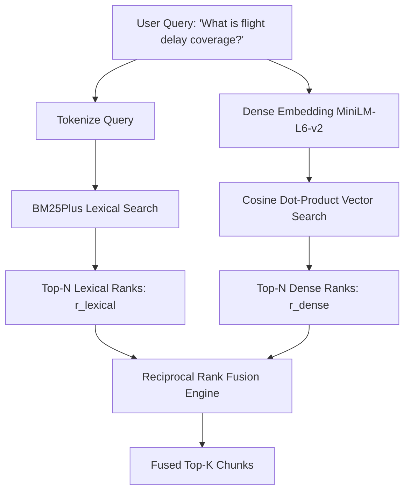

# Phase 2: Hybrid Retrieval & Ground Truth Benchmark

**Phase Status:** **DONE (100%)** ✅  
**Primary Files:** [`src/storage.py`](file:///d:/rag-practice/src/storage.py), [`src/retriever.py`](file:///d:/rag-practice/src/retriever.py)  
**Tests & Benchmarks:** [`tests/test_storage.py`](file:///d:/rag-practice/tests/test_storage.py), [`tests/test_retriever.py`](file:///d:/rag-practice/tests/test_retriever.py), [`tests/test_benchmark_td.py`](file:///d:/rag-practice/tests/test_benchmark_td.py)  

---

> [!NOTE]
> **Phase 5 Evolution**: In Phase 5, this local dual-artifact retrieval engine was elevated to a **Qdrant Cloud Native Hybrid Architecture** (`QdrantStorageManager` + `HybridParentRetriever`) utilizing cloud-native BM25 sparse vectors, BGE-base (768-d), and server-side RRF fusion. See [Phase 5 Guide](PHASE_5_PARENT_DOCUMENT_QDRANT.md).

## 1. Objectives & Architectural Goal

Insurance documents require an information retrieval system that excels in two contrasting search modalities:
1. **Exact Lexical Search**: Catching specific numbers (e.g. `"$1,000"`, `"$85,000"`), durations (`"4 hours"`, `"90 days"`, `"48 consecutive days"`), and legal terms (`"pre-existing"`, `"subrogation"`).
2. **Dense Semantic Search**: Matching natural language queries where phrasing diverges from policy language (e.g., *"Can I get money back if my flight was cancelled because of an emergency?"*).

Phase 2 builds a **Dual-Index Hybrid Retriever** that unites Lexical BM25Plus and Dense Sentence-Transformers (`all-MiniLM-L6-v2`) via **Reciprocal Rank Fusion (RRF)**.

---

## 2. Component Breakdown

### 2.1 Index Persistence: `src/storage.py`
`StorageManager` manages card-scoped index artifacts on disk under `.index/<card_id>/`:
- `chunks.json`: Full document chunks, breadcrumbs, page numbers, and content.
- `bm25.pkl`: Serialized `rank_bm25.BM25Plus` index trained on chunk tokens.
- `embeddings.npy`: L2-normalized 384-dimensional dense vector embeddings generated by `sentence-transformers/all-MiniLM-L6-v2`.

```text
.index/
└── td_aeroplan_vip/
    ├── chunks.json       # Parsed chunks with breadcrumbs
    ├── bm25.pkl          # Pickled BM25Plus model
    └── embeddings.npy    # Normalized dense float32 vector matrix
```

### 2.2 Dual Search & Reciprocal Rank Fusion: `src/retriever.py`
`HybridRetriever` runs dual candidate retrievals in parallel and fuses results:



#### Reciprocal Rank Fusion (RRF) Formula
For each candidate chunk $d$:
$$\text{RRF Score}(d) = \sum_{m \in \{\text{BM25}, \text{Dense}\}} \frac{1}{k + \text{rank}_m(d)}$$
Where $k = 60$ (smoothing constant). RRF eliminates score scale discrepancies between unbounded BM25 scores and cosine similarities, preventing either engine from dominating.

---

## 3. Ground Truth Benchmark Suite (`tests/test_benchmark_td.py`)

To evaluate retrieval quality objectively, we maintain a 10-query benchmark reflecting the most common and challenging insurance questions on the TD Aeroplan VIP Card:

| Query # | Test Domain | User Query | Target Pages | Required Keywords |
| :--- | :--- | :--- | :--- | :--- |
| **1** | Flight Delay | What is the minimum delay time and maximum coverage for flight delay? | Page 31–32 | `1,000`, `4 hours` |
| **2** | Medical Pre-Existing | What are the pre-existing medical condition stability requirements? | Pages 4, 7–8 | `stable`, `pre-existing` |
| **3** | Auto Rental Collision | What is the maximum MSRP for rental car collision damage coverage? | Page 38 | `85,000`, `msrp` |
| **4** | Baggage Delay | How long must my baggage be delayed before I can purchase essential items? | Page 29 | `4 hours`, `1,000` |
| **5** | Mobile Device Insurance | What is the mobile device insurance maximum limit and deductible? | Page 46 | `1,500`, `$100` / `deductible` |
| **6** | Medical Age Cutoff | How many days of travel medical coverage do I get if I am 65 or older? | Pages 1, 3, 4, 10 | `4 consecutive days`, `65` |
| **7** | Trip Cancellation | Is voluntary change of travel plans covered under trip cancellation? | Pages 16, 18 | `cancellation` |
| **8** | Extended Warranty | How long is the warranty doubled under extended warranty protection? | Page 40 | `warranty` |
| **9** | Hotel Burglary | What is the limit for hotel or motel burglary coverage? | Page 50 | `2,500`, `burglary` |
| **10** | Uncovered Negative | Does this insurance certificate cover pet health emergencies during travel? | `None` | (Negative control) |

---

## 4. Exit Criteria & Sign-Off Checklist

- [x] All 10 benchmark queries pass with 100% precision on target pages and key coverage terms.
- [x] End-to-end retrieval latency under 150ms on local CPU.
- [x] Unit tests passing in `tests/test_storage.py` and `tests/test_retriever.py`.
