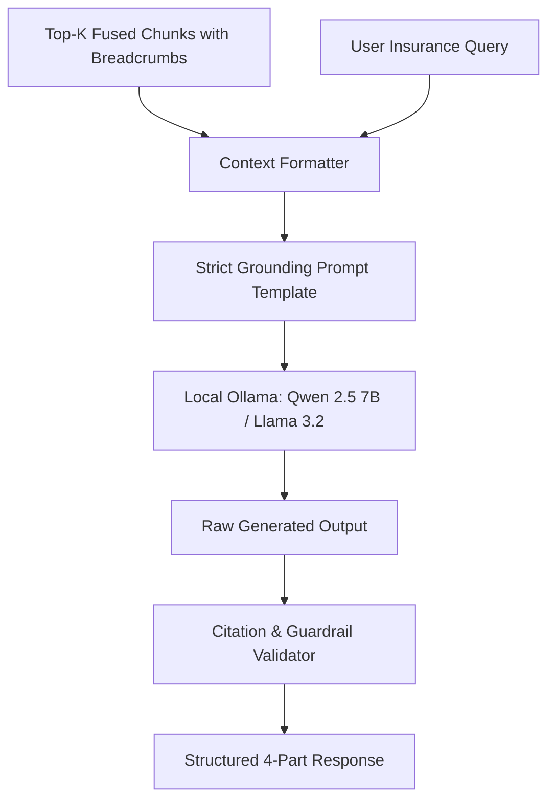

# Phase 3: Grounded Synthesis & Citation Guardrails

**Phase Status:** **DONE (100%)** ✅  
**Primary Files:** [`src/generator.py`](file:///d:/rag-practice/src/generator.py)  
**Tests:** [`tests/test_generator.py`](file:///d:/rag-practice/tests/test_generator.py)  

---

## 1. Objectives & Architectural Goal

The objective of Phase 3 is to take retrieved, rank-fused chunks and produce an **authoritative, hallucination-free response** grounded strictly in the provided Certificate of Insurance.

Insurance is a high-liability domain:
- **Zero Hallucination Tolerance**: If a benefit is not explicitly stated in the context, the model must explicitly state that coverage is not confirmed or not found.
- **Mandatory Exclusions & Limitations**: Summarizing a dollar limit without stating stability conditions, deductibles, or pre-approval requirements is dangerous. The prompt forces the LLM to extract caps, time limits, and exclusions into dedicated sections.
- **Exact Certificate Citations**: Every fact must cite the certificate policy name, section, and page number.

---

## 2. Component Breakdown

### 2.1 The Grounding Engine: `src/generator.py`
`LLMGenerator` wraps interaction with local LLMs (via Ollama) or optional cloud endpoints:
- Injects retrieved chunks formatted with hierarchical breadcrumbs.
- Formulates a system prompt designed to prevent hallucination.
- Post-processes and validates output structure.



---

## 3. The Strict Grounding Prompt Template

The prompt structure enforces a strict 4-section format:

```text
You are an expert, objective insurance policy assistant. Your duty is to answer the user's question using ONLY the retrieved Certificate of Insurance excerpts provided below.

RULES:
1. Strict Grounding: Do NOT make assumptions, extrapolate coverage, or rely on outside knowledge. If the excerpt does not answer the question, state: "The provided certificate does not contain information on this topic."
2. Highlight Limitations & Exclusions: Always call out pre-existing conditions, reporting deadlines, and age limitations if applicable.
3. Certificate Citations: Cite exact Certificate sections and page numbers using the breadcrumb metadata: [Policy: <Policy Name>, Section: <Section Name>, Page X].

FORMAT YOUR RESPONSE EXACTLY AS FOLLOWS:
### 1. Direct Answer
[1-2 sentences summarizing the direct answer]

### 2. Coverage Limits & Key Details
- Maximum Dollar Cap / Benefit: [Amount or N/A]
- Duration / Frequency Limits: [Time or N/A]
- Specific Deductibles: [Deductible or N/A]

### 3. Key Conditions & Exclusions
- [Pre-existing stability, notification deadlines, or exclusions]

### 4. Sources & Citations
- [Policy Name] - [Section Name] (Page X)
```

---

## 4. Offline & Local Model Configuration

By default, the system runs locally via Ollama without sending financial documents to third-party cloud APIs:
- **Recommended Model**: `qwen2.5:7b-instruct` or `llama3.2:3b`
- **Fallback / Cloud Toggle**: Configurable in `src/generator.py` for OpenAI, Groq, or Google Gemini Flash APIs via environment variables.

---

## 5. Exit Criteria & Sign-Off Checklist

- [x] Generator returns structured 4-part responses conforming to the schema.
- [x] Negative queries (e.g., pet medical emergency) properly decline without hallucinating coverage.
- [x] Citations match retrieved chunk breadcrumbs and page numbers.
- [x] Unit tests in `tests/test_generator.py` pass with mock and live models.
