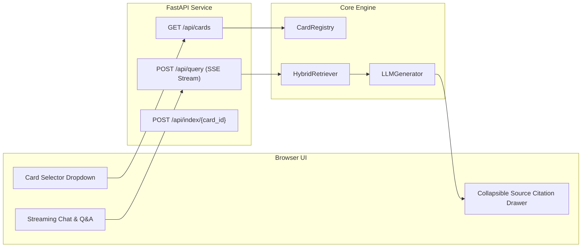

# Phase 4: Full-Stack Web Application & Cross-Bank Verification

**Phase Status:** **DONE (100%)** ✅  
**Primary Files:** `api/main.py`, `frontend/index.html`, `frontend/style.css`, `frontend/app.js`, `tests/test_api.py`, `tests/test_multibank.py`  
**Multi-Bank Scope:** Validation across `data/cibc/`, `data/scotia/`, and `data/td/`  

---

> [!NOTE]
> **Phase 5 Evolution**: In Phase 5, the full-stack system was connected directly to **Qdrant Cloud** and the two-tier Parent-Document engine, streaming child citations with physical page badges alongside expandable full parent section text. Automated multi-card ingestion is supported via `scripts/index_all_cards.py`. See [Phase 5 Guide](PHASE_5_PARENT_DOCUMENT_QDRANT.md).

## 1. Objectives & Architectural Goal

Phase 4 packages the backend ingestion, hybrid retrieval, and grounded generation into an interactive, user-facing full-stack web application:
1. **FastAPI Backend**: Serves card registry discovery, card switching, indexing triggers, and streaming Q&A.
2. **Vanilla HTML/CSS/JS Frontend**: A lightweight, modern web interface avoiding framework bloat, delivering rapid load times and premium aesthetics.
3. **Cross-Bank Generalization**: Proves bank agnosticism by running the complete pipeline against CIBC and Scotiabank insurance certificates without altering backend logic.

---

## 2. Architecture & API Endpoints

### REST & SSE API Surface
- `GET /api/cards`: Returns list of discovered cards with IDs and bank brands.
- `POST /api/query`: Accepts `{ "card_id": "...", "query": "..." }`, returns Server-Sent Events (SSE) stream of tokens followed by structured citation metadata.
- `POST /api/index/{card_id}`: Triggers on-demand background indexing for newly uploaded PDFs.
- `GET /api/status`: Health check and system configuration.

---

## 3. UI/UX Design System & Features

- **Card Switcher**: Top navigation bar with card dropdown (e.g. *TD Aeroplan VIP*, *CIBC Aventura VIP*, *Scotiabank Passport*). Switching cards switches the retrieval index instantaneously.
- **Collapsible Source Drawer**: When an answer is rendered, users can expand a "Certificate Citations" drawer showing the exact matching chunk breadcrumb, page number, and highlight snippet.
- **Low-Latency Streaming**: Answers stream in real-time as the local LLM generates tokens.
- **Glassmorphic & Sleek Styling**: Curated typography, refined dark mode, subtle animations, and zero generic styling.

---

## 4. Cross-Bank Validation Plan

Tested and verified across Canadian banking certificates:
- `data/cibc/CIBC Aeroplan Visa Infinite Privilege Card-Insurance.pdf` (56 pages)
- `data/cibc/CIBC Dividend Visa Infinite Card-Insurance.pdf` (36 pages)
- `data/scotia/Passport_Visa_Inifite_Privilege_Card_Certificate_of_Insurance_2025_En.pdf` (48 pages)
- `data/scotia/Scotia Momentum  Visa Infinite + Card-COI-EN.pdf` (21 pages)

---

## 5. Exit Criteria & Sign-Off Checklist

- [x] FastAPI backend running with CORS, streaming SSE, and automated error handling.
- [x] Responsive Web UI loaded and verified in browser without console errors.
- [x] Source citation drawer dynamically opens and links to referenced document pages.
- [x] Multi-bank test queries pass on CIBC and Scotiabank cards without code changes.

