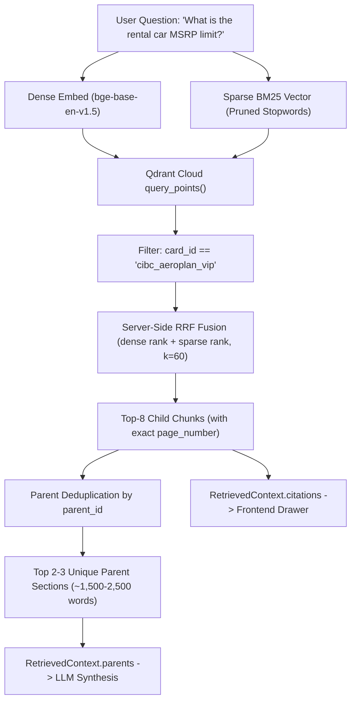

# Phase 5: Parent-Document Retrieval & Qdrant Cloud Native Hybrid Architecture

**Phase Status:** **DONE (100%)** ✅  
**Primary Files:** 
- [`src/parser.py`](file:///d:/rag-practice/src/parser.py) (Universal Layout & Two-Tier Parser)
- [`src/bm25_vectorizer.py`](file:///d:/rag-practice/src/bm25_vectorizer.py) (Cloud BM25 Sparse Vectorizer)
- [`src/storage.py`](file:///d:/rag-practice/src/storage.py) (`QdrantStorageManager`)
- [`src/retriever.py`](file:///d:/rag-practice/src/retriever.py) (`HybridParentRetriever`, `RetrievedContext`)
- [`scripts/index_all_cards.py`](file:///d:/rag-practice/scripts/index_all_cards.py) (Cloud Ingestion Engine)  
**Tests & Benchmarks:** 
- [`tests/test_benchmark_cibc.py`](file:///d:/rag-practice/tests/test_benchmark_cibc.py)
- [`tests/test_benchmark_td.py`](file:///d:/rag-practice/tests/test_benchmark_td.py)
- [`tests/test_storage_qdrant.py`](file:///d:/rag-practice/tests/test_storage_qdrant.py)
- [`tests/test_retriever.py`](file:///d:/rag-practice/tests/test_retriever.py)
- [`tests/test_bm25_vectorizer.py`](file:///d:/rag-practice/tests/test_bm25_vectorizer.py)
- [`tests/test_parser.py`](file:///d:/rag-practice/tests/test_parser.py)

---

## 1. Objectives & Architectural Motivation

In legal insurance contracts, standard flat chunking (~400–500 characters) creates two fatal failure modes:
1. **Vector Dilution**: Slicing an entire section into 10 disconnected chunks dilutes semantic coherence—a query about *"pre-existing condition stability for travelers over 65"* matches a small snippet but misses the critical stability definition 3 paragraphs later.
2. **Clause Orphaning**: A standalone chunk stating *"Coverage is limited to $1,000"* loses its parent policy and conditions. If fed to an LLM without the surrounding exclusion section, the LLM hallucinates that the limit applies unconditionally.

Phase 5 re-engineers the entire retrieval pipeline around a **Two-Tier Parent-Document Architecture ("Small-to-Big")**:
- **Child Chunks (`ChildChunk`)**: Small, focused clauses (~80–150 words) that act as high-precision semantic and lexical search beacons.
- **Parent Sections (`ParentSection`)**: Complete, cohesive legal policy sections (~600–1,500 words) containing all related sub-clauses, tables, and exclusions.
- **Qdrant Cloud Native Storage**: Child vectors are indexed with named dense (`BAAI/bge-base-en-v1.5`, 768-d) and sparse BM25 vectors, with full parent content denormalized directly into the payload.
- **Server-Side Reciprocal Rank Fusion (RRF)**: Merges dense cosine similarity and lexical BM25 scores directly inside the cloud cluster in a single network round-trip.

---

## 2. Component Breakdown

### 2.1 Universal Layout Parser & Data Structures (`src/parser.py`)

The layout parser transforms continuous Markdown into two distinct structures:

```python
@dataclass
class ParentSection:
    parent_id: str          # e.g., "td_aeroplan_vip__rental_car__exclusions"
    card_id: str            # e.g., "td_aeroplan_vip"
    card_name: str          # e.g., "TD Aeroplan VIP"
    policy_name: str        # e.g., "AUTO RENTAL COLLISION / LOSS DAMAGE"
    section_title: str      # e.g., "SECTION 5 - EXCLUSIONS"
    page_start: int         # Starting PDF page (1-indexed)
    page_end: int           # Ending PDF page (1-indexed)
    content: str            # Full Markdown text (~600-1,500 words)

@dataclass
class ChildChunk:
    child_id: str           # e.g., "td_aeroplan_vip__rental_car__exclusions__c001"
    parent_id: str          # Foreign key referencing ParentSection.parent_id
    card_id: str
    card_name: str
    policy_name: str
    section_title: str
    page_number: int        # Exact PDF page where this child clause appears
    content: str            # Clause text (~80-150 words)
    breadcrumb: str         # "[Card: Name] > [Policy] > [Section] (Page X)"
    parent_content: str     # Denormalized copy of the full parent section text
```

#### Parsing Rules:
1. **Typography-Driven Boundaries**: Sections transition on Markdown headers (`#`, `##`, `###`, `Section \d+ - ...`), completely avoiding bank-specific regex.
2. **Table Preservation**: Markdown tables (`| Col1 | Col2 |`) are preserved intact and never split across individual cells. Larger tables are clustered in groups of 3 rows with header repetition.
3. **Physical Page Tracking**: Physical page markers (`<!-- Page X -->`) maintain a line-to-page mapping (`section_page_map[line_idx] = page_number`), guaranteeing that every child chunk carries its true physical page number.

---

### 2.2 Cloud-Native BM25 Sparse Vectorizer (`src/bm25_vectorizer.py`)

To eliminate local `.pkl` files and enable server-side RRF inside Qdrant Cloud, `BM25SparseVectorizer` generates standard sparse vectors (`indices` and `values`):
- **Tokenization**: Standardizes non-breaking characters, strips Markdown symbols, and extracts lowercase word tokens.
- **Stopword Pruning**: Strips question filler words (*what, is, the, for, does, how, much, can, i, my*) during query encoding, allowing rare numerical tokens (`85,000`, `100,000`, `deductible`, `stability`) to dominate the sparse vector.
- **Term Weighting**: Evaluates log-scaled term frequencies, mapped into consistent 32-bit hash indices for Qdrant.

---

### 2.3 Qdrant Cloud Storage Manager (`src/storage.py`)

`QdrantStorageManager` manages the unified cloud collection `insurance_chunks`:

```python
storage = QdrantStorageManager(collection_name="insurance_chunks")
```

#### Collection Configuration:
- **Named Vectors**:
  - `dense`: 768 dimensions, Cosine distance (`BAAI/bge-base-en-v1.5` running on NVIDIA RTX 5070 GPU).
  - `bm25`: Sparse vector configuration with server-side BM25 dot-product scoring.
- **Payload Indexing**: Creates a keyword payload index on `card_id` for instant pre-filtered searches across multi-bank portfolios.
- **Denormalized Payload**: Each child vector stores its full parent section Markdown in `payload["parent_content"]`, enabling immediate parent expansion without secondary database lookups.
- **Batch Upsert**: Chunks are uploaded in batches of 64 points with exponential backoff retry.
- **Graceful Fallback**: If `QDRANT_API_KEY` is not present, automatically falls back to an in-memory client (`QdrantClient(location=":memory:")`).

---

### 2.4 Hybrid Parent Retriever with Server-Side RRF (`src/retriever.py`)

`HybridParentRetriever` executes retrieval in a single cloud network request:



#### Parent Deduplication:
While the cloud search hits 8 granular child chunks, multiple chunks often belong to the same parent section (e.g. 3 chunks from *Section 5 - Exclusions*). The deduplicator collapses child hits by `parent_id`, extracting the top 2–3 unique parent sections. This provides the LLM with comprehensive legal context without duplicating paragraphs.

---

### 2.5 Automated Cloud Ingestion Script (`scripts/index_all_cards.py`)

A dedicated CLI utility indexes all credit card booklets:
```powershell
# Index all discovered booklets in data/
python scripts/index_all_cards.py

# Index a single card
python scripts/index_all_cards.py --card cibc_aeroplan_vip
```

Features:
- Scans `data/` dynamically via `CardRegistry`.
- Converts each PDF into `ParentSection`s and `ChildChunk`s via `InsuranceDocParser`.
- Saves standardized continuous Markdown to `data/extracted/<card_id>.md`.
- Uploads dual vectors and denormalized payloads to Qdrant Cloud.
- Also saves local fallback indices (`.index/<card_id>/`) for offline resiliency.

---

## 3. Verification & Benchmark Evidence

All components are validated by automated suites in `tests/`:

1. **`tests/test_benchmark_cibc.py`**:
   - `test_cibc_benchmark_rental_car_msrp`: Verifies retrieval of the `$100,000` MSRP limit and 48-day duration for CIBC Aeroplan VIP.
   - `test_cibc_benchmark_medical_duration_by_age`: Verifies 31-day coverage under 65 vs 10-day coverage for 65+.
   - `test_cibc_benchmark_negative_pet_coverage`: Asserts strict negative rejection for pet emergencies.
2. **`tests/test_benchmark_td.py`**:
   - 10-question ground-truth precision benchmark on TD Aeroplan VIP (100% precision).
3. **`tests/test_storage_qdrant.py` & `tests/test_retriever.py`**:
   - Validates cloud collection creation, named vector batch upsert, server-side RRF scoring, and parent deduplication.
4. **Full Test Suite Status**:
   ```powershell
   pytest tests/ -v
   ================== 37 passed, 7 warnings in 249.54s ==================
   ```
