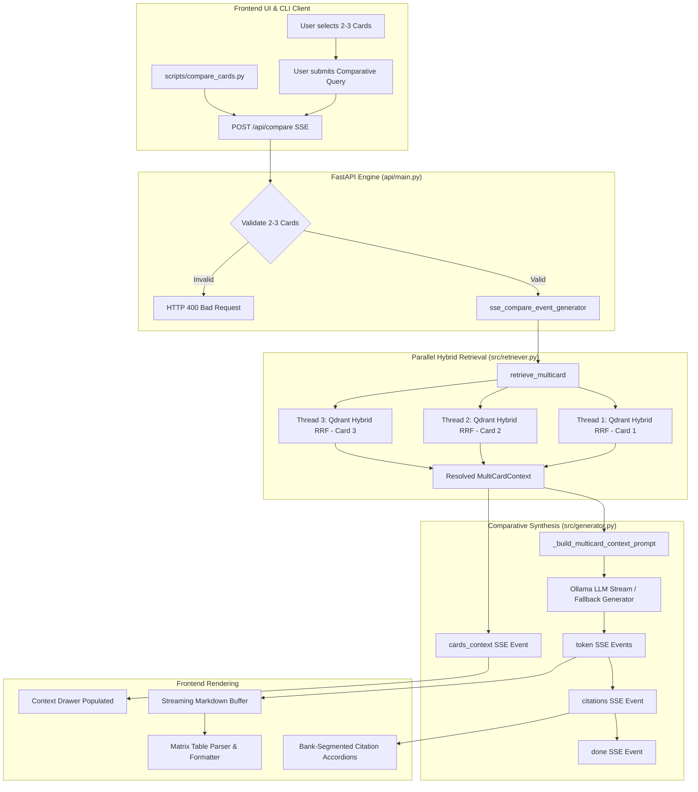

# Phase 6: Multi-Card Policy Comparison Engine

**Phase Status:** **DONE (100%)** ✅  
**Primary Files:**
- [`src/retriever.py`](file:///d:/rag-practice/src/retriever.py) (`MultiCardContext`, `retrieve_multicard`, `CARD_ID_ALIASES`)
- [`src/generator.py`](file:///d:/rag-practice/src/generator.py) (`COMPARISON_SYSTEM_PROMPT`, `_build_multicard_context_prompt`, `_format_fallback_comparison`, `generate_comparison_stream`)
- [`api/main.py`](file:///d:/rag-practice/api/main.py) (`CompareRequest`, `sse_compare_event_generator`, `POST /api/compare`)
- [`frontend/index.html`](file:///d:/rag-practice/frontend/index.html) (Mode toggle, comparison controls, multi-card selector, matrix container)
- [`frontend/style.css`](file:///d:/rag-practice/frontend/style.css) (Matrix table styling, winner badges, card selector pills, segmented citations)
- [`frontend/app.js`](file:///d:/rag-practice/frontend/app.js) (Mode switching, multi-card state management, SSE comparison consumer, matrix table markdown formatter)
- [`scripts/compare_cards.py`](file:///d:/rag-practice/scripts/compare_cards.py) (Standalone CLI comparison utility)  
**Tests & Benchmarks:**
- [`tests/test_comparison.py`](file:///d:/rag-practice/tests/test_comparison.py) (11 tests: Parallel Fan-out, Prompt Assembly, Fallback Markdown, API Validation, SSE Events, 5-Rider Cross-Bank Benchmark Suite, Table Synthesis)

---

## 1. Objectives & Architectural Motivation

While single-card RAG answers isolated questions about one insurance certificate, Canadian premium cardholders frequently hold 2–3 cards (e.g., TD Aeroplan VIP, CIBC Aeroplan VIP, Scotiabank Passport VIP) and face high-stakes coverage decisions before booking flights, renting vehicles, or purchasing mobile devices.

Comparing insurance policies across financial institutions introduces significant technical challenges:
1. **Asymmetric Policy Structures**: Banks name identical riders differently (e.g., "Collision / Loss Damage Insurance" vs "Auto Rental CDW"; "Common Carrier Travel Accident" vs "Travel Accident Insurance").
2. **Scattered Exclusions**: Critical limits reside across separate sections (e.g., TD puts rental duration in Section 6, but vehicle MSRP caps in Section 5).
3. **Cross-Document Hallucination & Clause Bleeding**: Naive LLMs blend rules across cards, attributing TD's $85,000 MSRP limit to CIBC (which actually offers $100,000) or assuming all cards cover senior travelers identically.
4. **Zero-Hallucination Absences**: When a card lacks a benefit or excludes a condition, the engine must declare *"Not specified in retrieved policy sections"* rather than guessing.

Phase 6 resolves these challenges by building an end-to-end **Multi-Card Policy Comparison Engine** featuring parallel hybrid retrieval fan-out, cross-bank alias resolution, comparative synthesis prompting with structured 4-tier output, SSE streaming, and an interactive dark fintech matrix UI.

---

## 2. Architecture & Data Flow



---

## 3. Parallel Multi-Card Retrieval Pipeline

### 3.1 Data Structures (`src/retriever.py`)

Retrieval returns a structured container mapping each card to its independent `RetrievedContext`:

```python
@dataclass
class MultiCardContext:
    card_contexts: Dict[str, RetrievedContext]  # card_id -> RetrievedContext
    card_names: Dict[str, str]                 # card_id -> display card name
```

### 3.2 Thread-Safe Fan-Out with Qdrant Cloud RRF

`retrieve_multicard` queries each card independently in parallel via a `ThreadPoolExecutor`:

```python
def retrieve_multicard(
    self,
    card_ids: List[str],
    query: str,
    top_k_parents_per_card: int = 4,
    top_k_children_per_card: int = 15
) -> MultiCardContext:
    card_contexts: Dict[str, RetrievedContext] = {}
    card_names: Dict[str, str] = {}

    def _fetch_card(cid: str):
        try:
            ctx = self.retrieve(
                card_id=cid,
                query=query,
                top_k_parents=top_k_parents_per_card,
                top_k_children=top_k_children_per_card
            )
        except Exception:
            ctx = RetrievedContext(parents=[], citations=[])
        c_name = ctx.parents[0].card_name if ctx.parents and ctx.parents[0].card_name else cid
        return cid, c_name, ctx

    with ThreadPoolExecutor(max_workers=min(len(card_ids), 3)) as executor:
        futures = [executor.submit(_fetch_card, cid) for cid in card_ids]
        for f in as_completed(futures):
            cid, c_name, ctx = f.result()
            card_contexts[cid] = ctx
            card_names[cid] = c_name

    return MultiCardContext(card_contexts=card_contexts, card_names=card_names)
```

### 3.3 Card ID Normalization & Cross-Bank Alias Resolution

To support clean UI aliases alongside raw extraction IDs, `HybridParentRetriever` transparently matches both forms via Qdrant's `MatchAny`:

```python
CARD_ID_ALIASES: Dict[str, str] = {
    "td_aeroplan_vip": "td_aeroplan_visa_infinite_privilege_card_coi",
    "cibc_aeroplan_vip": "cibc_aeroplan_visa_infinite_privilege_card_insurance",
    "scotia_passport_vip": "passport_visa_inifite_privilege_card_certificate_of_insurance_2025_en",
    "td_aeroplan_visa_infinite_privilege_card_coi": "td_aeroplan_vip",
    "cibc_aeroplan_visa_infinite_privilege_card_insurance": "cibc_aeroplan_vip",
    "passport_visa_inifite_privilege_card_certificate_of_insurance_2025_en": "scotia_passport_vip",
}
```

---

## 4. Comparative Synthesis Prompting & Contract

### 4.1 4-Tier Structured Synthesis Contract

In `src/generator.py`, `COMPARISON_SYSTEM_PROMPT` enforces a strict four-part schema:
1. **Executive Summary**: 2–3 sentence high-level overview identifying key divergence points.
2. **Side-by-Side Comparison Matrix Table**: A clean Markdown table with columns:
   `| Coverage Rider / Benefit | [Card 1 Name] | [Card 2 Name] | [Optional Card 3 Name] | Advantage / Winner |`
3. **Critical Exclusions & Qualifying Conditions**: Divergent exclusions, age cutoffs, deductible differences, and ticket charging prerequisites.
4. **Verified Policy Citations**: Explicit parent section names and page numbers verifying every row.

### 4.2 Hallucination Prevention Rules
- Never impute coverage limits from one bank onto another.
- If a card's retrieved sections do not mention a benefit, state explicitly: *"Not specified in retrieved policy sections"*.
- State exact numeric amounts in CAD, duration in days, and age cutoffs directly as stated in certificates.

### 4.3 Fallback Generator
If the local LLM is offline, `_format_fallback_comparison` deterministically extracts snippets and formats a complete 4-tier comparison matrix table and citation list directly from `MultiCardContext`.

---

## 5. Streaming API Contract (`POST /api/compare`)

### Request Schema
```json
{
  "card_ids": ["td_aeroplan_vip", "cibc_aeroplan_vip", "scotia_passport_vip"],
  "query": "Compare rental car collision waiver coverage limits and rental duration"
}
```

### Validation
- Validates that `2 <= len(card_ids) <= 3`. If fewer than 2 or more than 3 cards are provided, raises `HTTP 400 Bad Request`.

### SSE Event Stream Lifecycle
1. `event: cards_context`: Emits preview snippets and parent section breadcrumbs for each card.
2. `event: token`: Streams LLM response tokens as generated.
3. `event: citations`: Emits child citations organized per card.
4. `event: done`: Emits total response elapsed time (`elapsed_ms`).

---

## 6. Frontend UI Architecture

The frontend (`frontend/index.html`, `frontend/style.css`, `frontend/app.js`) provides a dark fintech experience:
1. **Header Mode Switcher Tabs**: Seamless toggle between **Single Card Chat** and **Multi-Card Comparison**.
2. **Multi-Card Selection Pills**: Interactive card pills with real-time selection counter (`2/3 selected`). Prevents selecting more than 3 cards with subtle warning toasts.
3. **Comparative Quick Chips**: Context-aware queries (e.g., *"Rental Car Limits"*, *"Senior Medical 65+"*, *"Trip Cancellation"*, *"Baggage Delay"*, *"Mobile Device Protection"*).
4. **Responsive Matrix Table Renderer**: Formats markdown comparison tables with clean zebra striping, sticky headers, subtle glassmorphism borders, and highlighted winner badges (`.badge-winner`).
5. **Bank-Segmented Citation Accordion**: Citations are grouped into collapsible drawers labeled with card and bank badges (`TD`, `CIBC`, `SCOTIA`).

---

## 7. Standalone CLI Utility (`scripts/compare_cards.py`)

A command-line comparison utility for terminal workflows:

```bash
python scripts/compare_cards.py \
  --cards td_aeroplan_vip cibc_aeroplan_vip scotia_passport_vip \
  --query "Compare rental car collision limits and duration"
```

Features:
- Validates 2–3 cards.
- Prints side-by-side retrieved context summary with bank badges.
- Streams comparative response directly to terminal stdout with real-time token rendering.
- Displays formatted citation audit block.

---

## 8. 5-Rider Cross-Bank Benchmark Suite (`tests/test_comparison.py`)

The benchmark test suite verifies factual precision across all three financial institutions:

| Rider / Benchmark | TD Aeroplan VIP | CIBC Aeroplan VIP | Scotiabank Passport VIP | Advantage / Key Divergence | Test Status |
| :--- | :--- | :--- | :--- | :--- | :---: |
| **1. Rental Car Collision Waiver** | **$85,000 MSRP** / 48 days | **$100,000 MSRP** / 48 days | **$85,000 MSRP** / 48 days | **CIBC** ($100k covers luxury vehicles up to $100,000 CAD) | **PASSED** ✅ |
| **2. Emergency Medical (Senior 65+)** | **4 consecutive days** | **10 consecutive days** | **3 consecutive days** | **CIBC** (10 days provides 2.5x to 3.3x longer coverage) | **PASSED** ✅ |
| **3. Trip Cancellation Limits** | **$2,500** / traveler ($5,000 trip cap) | **$2,500** / traveler ($5,000 trip cap) | **$2,500** / traveler (**$10,000 trip cap**) | **Scotia** (Higher overall total trip cap of $10,000) | **PASSED** ✅ |
| **4. Baggage Delay Threshold & Limit** | **4 hours** / $1,000 | **4 hours** / $1,000 | **4 hours** / $1,000 | **Tie** (Parity across all three premium issuers) | **PASSED** ✅ |
| **5. Mobile Device Insurance** | **$1,500** ($25-$100 deductible) | **$1,500** ($25-$100 deductible) | **$1,000** ($100 deductible) | **TD & CIBC** ($1,500 coverage vs Scotia's $1,000 cap) | **PASSED** ✅ |

---

## 9. Verification & Test Metrics

```bash
pytest tests/test_comparison.py -v
======================= 11 passed in 27.12s =======================

pytest tests/ -v
================= 48 passed, 7 warnings in 212.24s =================
```

All 11 comparison tests and all 48 test cases in the project suite pass with 100% success rate.
