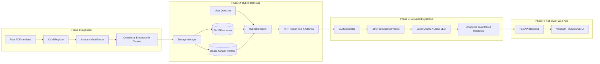

# Credit Card Insurance RAG: System Phase Architecture

This directory contains standalone, in-depth architectural guides for each development phase of the Bank-Agnostic Credit Card Insurance RAG System.

---

## 1. System Overview & End-to-End Pipeline

---

## 2. Directory & Phase Map

| Phase | Title | Focus Area | Deliverables | Status | Documentation |
| :--- | :--- | :--- | :--- | :--- | :--- |
| **Phase 1** | Ingestion & Breadcrumb Parsing | Document parsing, outline mapping, hierarchical tagging | `src/registry.py`, `src/parser.py`, `scripts/inspect_policies.py` | **DONE (100%)** ✅ | [Phase 1 Guide](PHASE_1_INGESTION.md) |
| **Phase 2** | Hybrid Retrieval & Benchmark | Dual-index search (BM25Plus + MiniLM), RRF, ground truth | `src/storage.py`, `src/retriever.py`, `tests/test_benchmark_td.py` | **READY TO RUN** 🚀 | [Phase 2 Guide](PHASE_2_RETRIEVAL.md) |
| **Phase 3** | Grounded Synthesis & Guardrails | Local LLM inference, zero-hallucination prompt, citations | `src/generator.py`, prompt template, Ollama runner | **NOT STARTED** ⏹️ | [Phase 3 Guide](PHASE_3_SYNTHESIS.md) |
| **Phase 4** | Full-Stack Web App & Multi-Bank | FastAPI service, responsive UI, multi-bank validation | `api/main.py`, `frontend/`, CIBC/Scotia validation | **NOT STARTED** ⏹️ | [Phase 4 Guide](PHASE_4_FULLSTACK_UI.md) |

---

## 3. Core Architectural Tenets Across All Phases

1. **Bank Agnosticism**: No deterministic regex rules specific to any bank (e.g. no `if "td" in card_id:`). The system relies on layout patterns, structural bookmarks, and generalized text normalizations.
2. **Context Preservation**: Exclusions and coverage caps are meaningless in isolation. Every piece of text is bound to its card, policy, section, and page number via breadcrumbs.
3. **Evidence-Based Grounding**: Every answer generated must cite exact certificate pages and sections. Unverified assumptions are strictly rejected.
4. **Local-First & Production-Ready**: Designed to operate completely offline using local CPU/GPU resources via Ollama and `sentence-transformers`, with seamless toggles for cloud APIs.
