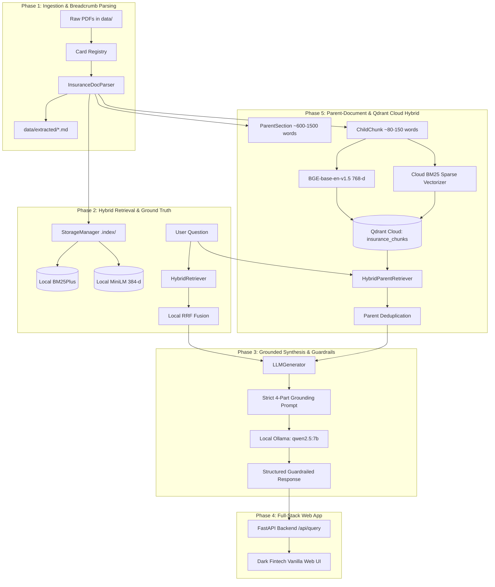

# Credit Card Insurance RAG: System Phase Architecture

This directory contains standalone, in-depth architectural guides for each development phase of the Bank-Agnostic Credit Card Insurance RAG System.

---

## 1. System Overview & End-to-End Pipeline

---

## 2. Directory & Phase Map

| Phase | Title | Focus Area | Deliverables | Status | Documentation |
| :--- | :--- | :--- | :--- | :--- | :--- |
| **Phase 1** | Ingestion & Breadcrumb Parsing | Document parsing, outline mapping, hierarchical tagging, markdown export | `src/registry.py`, `src/parser.py`, `scripts/inspect_policies.py` | **DONE (100%)** ✅ | [Phase 1 Guide](PHASE_1_INGESTION.md) |
| **Phase 2** | Hybrid Retrieval & Benchmark | Dual-index search (BM25Plus + MiniLM), RRF, ground truth precision | `src/storage.py`, `src/retriever.py`, `tests/test_benchmark_td.py` | **DONE (100%)** ✅ | [Phase 2 Guide](PHASE_2_RETRIEVAL.md) |
| **Phase 3** | Grounded Synthesis & Guardrails | Local LLM inference, zero-hallucination prompt, negative control rejection | `src/generator.py`, `scripts/eval_synthesis.py`, `scripts/query.py` | **DONE (100%)** ✅ | [Phase 3 Guide](PHASE_3_SYNTHESIS.md) |
| **Phase 4** | Full-Stack Web App & Multi-Bank | FastAPI service, SSE streaming, Dark Fintech UI, cross-bank validation | `api/main.py`, `frontend/`, `tests/test_multibank.py` | **DONE (100%)** ✅ | [Phase 4 Guide](PHASE_4_FULLSTACK_UI.md) |
| **Phase 5** | Parent-Document & Qdrant Cloud | Two-tier layout parsing, cloud BM25 sparse vectors, server-side RRF fusion | `src/bm25_vectorizer.py`, `src/storage.py`, `src/retriever.py`, `scripts/index_all_cards.py` | **DONE (100%)** ✅ | [Phase 5 Guide](PHASE_5_PARENT_DOCUMENT_QDRANT.md) |

---

## 3. Core Architectural Tenets Across All Phases

1. **Bank Agnosticism**: No deterministic regex rules specific to any bank (e.g. zero `if "td" in card_id:`). The system relies purely on layout typography, heading hierarchy (`#`, `##`, `###`), table boundaries (`|`), and generalized text normalizations.
2. **Context Preservation (Small-to-Big)**: Exclusions and coverage caps are meaningless in isolation. Every piece of text is bound to its card, policy, section, and page number via breadcrumbs, while full legal parent sections are denormalized into vector payloads to prevent clause orphaning.
3. **Evidence-Based Grounding**: Every answer generated must cite exact certificate pages and sections. Unverified assumptions are strictly rejected with zero hallucination tolerance.
4. **Cloud-Native Scalability with Offline Graceful Fallback**: Primary operations leverage Qdrant Cloud for unified dense + sparse hybrid search with server-side RRF, with automatic fallback to local memory (`:memory:`) or disk (`.index/`) during offline operation or local testing.
5. **Continuous Verification**: A comprehensive 37-test automated verification suite (`pytest tests/ -v`) continuously asserts end-to-end correctness across all banks and modules.
