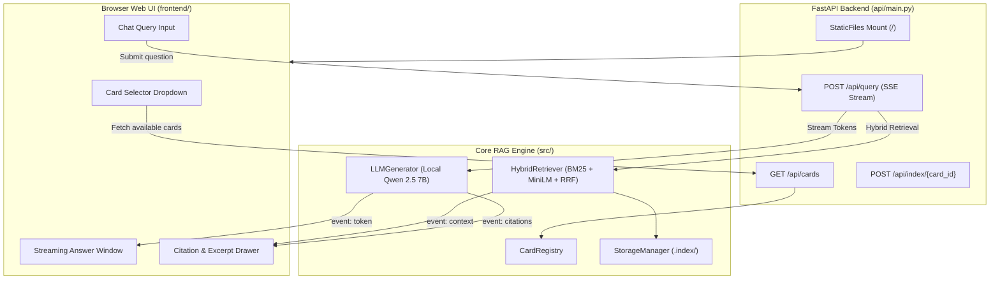

# Phase 4 Design Specification: Full-Stack Web Application & Cross-Bank Verification

**Date:** 2026-10-26  
**Status:** Approved & Ready for Plan  
**Target Delivery:** FastAPI Backend Service, Vanilla HTML/CSS/JS Frontend, Multi-Bank Ingestion  

---

## 1. Overview & Objectives

Phase 4 packages the Credit Card Insurance RAG system into an interactive, high-performance, full-stack web application. The solution bridges backend retrieval and local LLM generation (`qwen2.5:7b`) with a modern, glassmorphic Web UI while validating end-to-end bank agnosticism across Canadian credit card insurance certificates from TD, CIBC, and Scotiabank.

### Key Goals:
1. **FastAPI Web Service**: Unifies API endpoints (`/api/cards`, `/api/query`, `/api/index/{card_id}`) and serves the static frontend directly from `frontend/` on `http://localhost:8000`.
2. **Server-Sent Events (SSE) Streaming**: Low-latency token streaming from local Ollama combined with structured payload events for retrieved context chunks and certificate citations.
3. **Sleek Dark Fintech Web UI**: A responsive, premium interface featuring deep slate backgrounds (`#080C14`), glassmorphic panels, dynamic card switching, and a collapsible source citation drawer.
4. **Cross-Bank Ingestion & Multi-Card Verification**: Automated testing across 7 credit card PDFs from TD, CIBC, and Scotiabank without code changes.

---

## 2. Architecture & Data Flow



---

## 3. Backend Specification (`api/main.py`)

### 3.1 Dependencies
* `fastapi>=0.115.0`
* `uvicorn>=0.30.0`
* `pydantic>=2.0.0`
* `httpx>=0.27.0`

### 3.2 Endpoints & Contracts

#### `GET /api/cards`
Returns all credit cards discovered across `data/` along with their index status and chunk count.
* **Response**:
```json
[
  {
    "card_id": "td_aeroplan_vip",
    "bank": "TD",
    "card_name": "TD Aeroplan Visa Infinite Privilege Card",
    "file_path": "d:/rag-practice/data/td/TD Aeroplan Visa Infinite Privilege Card COI.pdf",
    "is_indexed": true,
    "total_chunks": 213
  }
]
```

#### `POST /api/query` (SSE Stream)
* **Request**:
```json
{
  "card_id": "td_aeroplan_vip",
  "query": "What is the minimum delay for flight delay coverage?"
}
```
* **Response Stream (`text/event-stream`)**:
  * `event: context`: JSON array of top-8 scored chunks (breadcrumbs, page numbers, scores, text snippets).
  * `event: token`: JSON string per generated token from Ollama (`qwen2.5:7b`).
  * `event: citations`: JSON array of verified citation references.
  * `event: done`: Execution timing metadata (`retrieval_ms`, `generation_ms`).

#### `POST /api/index/{card_id}`
Triggers on-demand ingestion and indexing for an unindexed card PDF.
* **Response**:
```json
{
  "status": "success",
  "card_id": "cibc_aventura_vip",
  "chunks_indexed": 198,
  "elapsed_seconds": 14.2
}
```

#### `GET /api/status`
Health check verifying local Ollama availability, active model, and index directory status.

---

## 4. Frontend Design System (`frontend/`)

### 4.1 Layout & Structure (`frontend/index.html`)
* **Header**:
  * Logo badge (`PolicyGuard RAG`).
  * Card switcher dropdown grouped by bank (`<optgroup label="TD Bank">`, etc.).
  * Real-time indexing badge indicator (`● Ready` / `○ Indexing`).
* **Main Container (Split Grid)**:
  * **Left Column (Chat Panel)**:
    * Welcome state with clickable suggested query chips.
    * Conversation thread with user message bubbles and assistant responses.
    * Streaming assistant response box with real-time Markdown formatting (headers, bold, lists, tables).
    * Bottom query input bar with submit button and loading animation.
  * **Right Column (Certificate Citations Drawer)**:
    * Collapsible on mobile / side-panel on desktop.
    * Summary card: active card, page count, retrieval confidence.
    * Individual citation cards showing document page badge, policy/section breadcrumb, and expandable quote snippet.

### 4.2 Styling & Aesthetics (`frontend/style.css`)
* **Theme**: Sleek Dark Fintech
* **Color Tokens**:
  * `--bg-base`: `#080C14`
  * `--bg-surface`: `#0E1526`
  * `--bg-card`: `#131C31`
  * `--border-subtle`: `rgba(255, 255, 255, 0.08)`
  * `--border-active`: `#06B6D4`
  * `--accent-emerald`: `#10B981`
  * `--accent-cyan`: `#06B6D4`
  * `--text-primary`: `#F8FAFC`
  * `--text-secondary`: `#94A3B8`
  * `--text-muted`: `#64748B`
* **Typography**: Google Fonts `Inter` (UI) and `JetBrains Mono` (code/breadcrumbs).
* **Interactions**: Smooth CSS transitions (`cubic-bezier(0.16, 1, 0.3, 1)`), hover lifts, subtle pulsing glow on streaming cursor.

### 4.3 Client Application Logic (`frontend/app.js`)
* Manages card selection and index caching.
* Connects to `/api/query` via `fetch` and consumes `ReadableStream` line-by-line.
* Parses SSE events (`event: context`, `event: token`, `event: citations`).
* Lightweight Markdown renderer formatting headings (`###`), bold (`**`), bullet points, and tables.

---

## 5. Cross-Bank Generalization (`tests/test_multibank.py`)

* Validates dynamic discovery of all 7 cards in `data/cibc/`, `data/scotia/`, and `data/td/`.
* Ingests representative CIBC and Scotiabank certificates.
* Runs hybrid queries on non-TD cards to confirm that outline mapping and breadcrumbs generalize without hardcoded rules.

---

## 6. Verification Criteria & Sign-Off

1. `api/main.py` starts with `uvicorn api.main:app` and serves frontend at `http://localhost:8000`.
2. Card switcher populates all cards and successfully switches context.
3. Asking a question streams tokens from Qwen 2.5 7B in real time.
4. The citation drawer accurately reflects matching document pages.
5. All automated unit and multi-bank tests pass (`pytest -v`).
